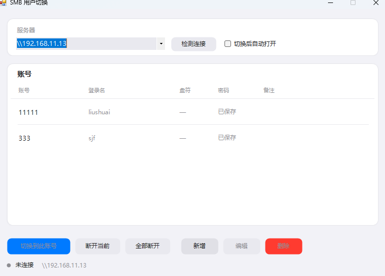
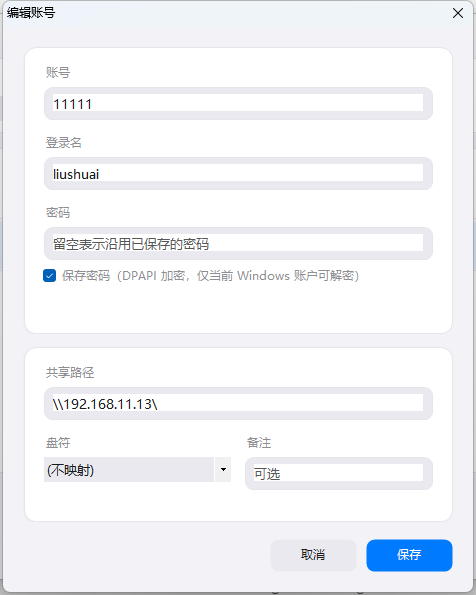

# SMB 用户切换

> 在 Windows 下快速切换访问同一个 SMB 共享所用的账号 —— 一键完成「断开旧会话 → 用新凭据重连 → 挂回固定盘符」。

**单文件 exe · 36 KB · 零依赖 · 无需管理员权限**

---

## 为什么需要它

Windows 的 SMB 重定向器在**每个登录会话 + 每个服务器名**下只保留一套凭据。当你想用另一个账号访问同一台服务器时，会直接撞上：

> 不允许一个用户使用一个以上用户名与一个服务器或共享资源的多重连接。（**错误 1219**）

手工绕过极其繁琐：

```
关掉所有资源管理器窗口 → net use * /delete /y
                      → net use \\server\share /user:xxx *
                      → 再重新打开目录
```

而且经常**关掉了窗口还是报 1219** —— 因为存在一条无盘符的隐藏 `IPC$` 会话，`net use` 默认看不见它。

本工具把这些步骤封装成一次点击。

---

## 功能

| 功能 | 说明 |
|---|---|
| **一键切换** | 自动断开该服务器全部旧连接（含隐藏 IPC$），用新凭据重连并挂回盘符 |
| **全部断开** | 一次断开本机所有网络连接，断开前列出清单请你确认 |
| **账号管理** | 增删改查，密码可选保存（DPAPI 加密） |
| **托盘常驻** | 右键托盘图标直接切账号，无需打开主窗口 |
| **占用检测** | 有程序正打开共享里的文件时，先提示再让你决定是否强制断开 |
| **Apple 风格界面** | 圆角卡片、系统色板、按钮悬停/按下补间动画 |

---

## 快速开始

### 直接使用

下载 `dist/SmbUserSwitch.exe`，双击运行。不需要安装任何运行时。

### 从源码构建

```
build.bat
```

产物为 `dist/SmbUserSwitch.exe`。编译用系统自带的 .NET Framework 编译器，无需安装 Visual Studio 或 .NET SDK。

### 配置步骤

1. 顶部填入服务器地址，例如 `\\192.168.11.13`
2. 点「新增」建立账号，填写：

   | 字段 | 说明 | 示例 |
   |---|---|---|
   | 账号 | 显示在列表里的名字 | `admin` |
   | 登录名 | 服务器上的用户名 | `administrator` |
   | 密码 | 可选保存（DPAPI 加密，仅当前 Windows 账户可解密） | |
   | 共享路径 | 完整 UNC 路径 | `\\192.168.11.13\share` |
   | 盘符 | 映射到的盘符，或选「不映射」 | `S:` |
   | 备注 | 可选 | `管理员账号` |

3. 双击账号即切换；也可右键任务栏托盘图标直接切

---

## 界面

<table>
<tr>
<td></td>
<td></td>
</tr>
</table>

Apple 风格界面，全部控件自绘。按钮带三层状态动画：**悬停**底色渐变（140ms）→ **按下**缩放至 96.5% 并加深（90ms）→ **松开**弹回（170ms），曲线为 easeOutCubic。

动画由 `Animator` 统一驱动，到达目标后**自动停表**，不空转占 CPU。

改配色或圆角只需动 `src/UI/Theme.cs` 一个文件。

---

## 工作原理

### 切换流程

```
1. 取密码      已保存则 DPAPI 解密；否则用本次会话输入的临时密码
2. 枚举连接    NetUseEnum 列出该服务器全部连接（含无盘符的 IPC$）
3. 逐个断开    有盘符的用本地名 "S:"，无盘符的用远程名 "\\server\share"
4. 兜底        盲断 \\server\IPC$，清除枚举不到的隐式会话
5. 回读校验    重新枚举确认真的断干净（返回值不可信，见下）
6. 重连        WNetAddConnection2，CONNECT_TEMPORARY，带新凭据
7. 错误分支    1219→提示关闭占用程序 / 1326→密码错 / 85→盘符占用 / 2401→询问强制断开
```

### 三个 Win32 陷阱（本项目已处理）

**1. `WNetEnumResource` 看不到无盘符的 IPC$ 会话**

`net use` 和 `WNetEnumResource` 都只显示带盘符的映射，而 IPC$ 恰恰是触发 1219 的常见元凶。

→ 改用 `netapi32.dll` 的 `NetUseEnum` level 2，它既能看到 IPC$，**还能读出当前连接的用户名**（主界面的"当前账号"就是这么来的）。

**2. `WNetCancelConnection2` 对名字的要求是不对称的**

| 连接类型 | 必须用 |
|---|---|
| 有盘符（`S:`） | **本地名** `S:` |
| 无盘符 | **远程名** `\\server\share` |

用错名字**不会报错**，只返回 `2250` 然后什么都不做。

→ 由于返回值不足以判断结果，`Disconnect()` 在断开后**重新枚举校验**，确认真的断干净才返回成功。

**3. `CONNECT_UPDATE_PROFILE` 会埋雷**

若用它建立连接，连接会被写进用户配置文件，下次登录时自动重连，再次触发 1219。

→ 统一使用 `CONNECT_TEMPORARY`，连接不持久化。

---

## 安全性

- **密码用 DPAPI 加密**（`DataProtectionScope.CurrentUser`）后存于 `%APPDATA%\SmbUserSwitch\config.xml`
- 换 Windows 账户或换机器**都无法解密** —— 这正是期望的隔离性
- 不勾选「保存密码」时，密码只留在内存中供本次会话使用，不落盘
- 配置文件写入采用 `File.Replace` 原子替换，旧版本留为 `.bak`
- 程序**不需要管理员权限**（manifest 声明 `asInvoker`），无 UAC 弹窗

---

## 项目结构

```
smb_changeuser/
├── build.bat                     一键编译
├── run-tests.bat                 编译并运行回归测试
├── dist/SmbUserSwitch.exe        成品（已提交）
├── src/
│   ├── app.manifest              asInvoker + PerMonitorV2 DPI
│   ├── Program.cs                入口 + 单实例互斥
│   ├── Native/
│   │   ├── Mpr.cs                mpr.dll P/Invoke + 错误码中文翻译
│   │   └── NetApi.cs             netapi32.dll NetUseEnum + 连接枚举
│   ├── Core/
│   │   ├── Models.cs             配置数据模型
│   │   ├── CredentialStore.cs    DPAPI 加解密 + XML 读写
│   │   └── SmbSessionManager.cs  枚举 / 断开 / 连接（核心）
│   └── UI/
│       ├── Theme.cs              设计令牌 + 补间动画引擎
│       ├── AppleButton.cs        自绘按钮（含点击动画）
│       ├── CardPanel.cs          圆角卡片 + 圆角输入框
│       ├── AccountList.cs        自绘账号列表
│       ├── MainForm.cs
│       ├── AccountEditForm.cs
│       └── TrayIcon.cs           图标运行时用 GDI+ 绘制，无外部资源
└── tests/
    ├── regression/               回归测试（含 1219 对照实验）
    └── diagnostics/              开发期一次性诊断脚本
```

---

## 测试

```
run-tests.bat
```

测试使用**本机回环 SMB**（`\\localhost`）作为靶子，不需要外部服务器或额外账号。

其中 `SwitchProof` 是一组对照实验，直接证明核心机制有效：

| | 结果 |
|---|---|
| **对照组**：已有连接时直接用别的用户名连 | 复现 **1219** ← 这就是要解决的错误 |
| **实验组**：先拆会话再连 | 变成 **1326**（认证失败）→ 会话确实用新凭据重建了 |

### 已验证场景

| 场景 | 结果 |
|---|---|
| 复现错误 1219（不拆会话直接换用户名） | ✅ 稳定复现 |
| 拆会话后换用户名 | ✅ 1219 消失，变为 1326 |
| 失败的连接尝试不破坏已有会话 | ✅ 已有会话完好 |
| 文件被占用时断开 | ✅ 返回 2401 并询问用户，不静默失败 |
| 强制断开 | ✅ 成功，盘符正确释放 |
| 隐藏 IPC$ 会话清理 | ✅ 彻底清除 |
| 全部断开（无连接 / 多连接 / 被占用 / 强制） | ✅ 四种情形均正确 |
| 盘符被占用 / 服务器不可达 / 密码错误 | ✅ 明确中文提示，不崩溃 |
| 配置读写与 DPAPI 往返 | ✅ 中文内容正常 |
| 单实例互斥 | ✅ 第二次启动自动退出 |
| 无 UAC 提权 | ✅ manifest 为 asInvoker |

---

## 已知限制

- **串行切换**：同一时刻只能有一个账号在线。若确实需要同时用两个账号访问同一台服务器，Windows 层面的绕法是**别名法** —— 往 `hosts` 加一行 `192.168.11.13  nas-u2`，则 `\\192.168.11.13\share` 与 `\\nas-u2\share` 会被重定向器视为两台不同的服务器，可各挂一套凭据。需要一次性管理员权限写 hosts，本工具未实现。
- **共享名需手动填写**完整 UNC 路径（不自动枚举共享列表，因为部分服务器禁用了 RPC 枚举）。
- 受系统自带 `csc.exe` 限制，代码使用 **C# 5 语法**（无字符串插值、无 `?.`、无表达式体成员）。
- 界面尺寸固定，不支持自由缩放（布局按像素手工计算）。

---

## 环境要求

- Windows 7 / 8 / 8.1 / 10 / 11
- .NET Framework 4.x（Windows 8 及以上系统自带）
- 不需要管理员权限

---

## 许可

MIT
